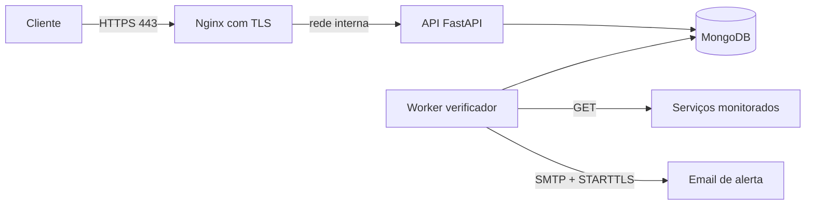

# App Health Monitor

[](https://github.com/amoras200/monitor-health-app/actions/workflows/ci.yml)

Monitor de disponibilidade de aplicações: cadastra URLs, verifica periodicamente se estão no ar, guarda o histórico no **MongoDB** e envia **alertas por email** quando um serviço cai e quando volta.

> Projeto de portfólio com foco em **suporte a aplicações**, **automação** e **segurança desde o início**.

## Como funciona



- **API (FastAPI):** cadastra serviços e mostra status e uptime das últimas 24h.
- **Worker (Python):** a cada ciclo, faz um GET em cada serviço, mede o tempo de resposta e grava o resultado.
- **Alertas:** só na *mudança de estado*. Cai depois de N falhas seguidas (padrão: 3) e avisa quando volta, sem enviar um email a cada checagem.
- **MongoDB:** coleções `services` e `checks`, índice TTL que apaga checagens com mais de 7 dias e *aggregation pipeline* para calcular uptime e tempo médio.

## Como rodar

Requisitos: Docker, Docker Compose e OpenSSL.

```bash
cp .env.example .env          # troque TODOS os valores (use: openssl rand -hex 32)
./scripts/gen-cert.sh         # certificado autoassinado, só para desenvolvimento
docker compose up --build -d
```

Testando (`-k` aceita o certificado autoassinado):

```bash
export API_KEY=...            # o mesmo valor do .env

curl -k https://localhost/health

curl -k -X POST https://localhost/services \
  -H "X-API-Key: $API_KEY" -H "Content-Type: application/json" \
  -d '{"name": "Exemplo", "url": "https://example.com"}'

curl -k https://localhost/services -H "X-API-Key: $API_KEY"
curl -k https://localhost/services/<id>/status -H "X-API-Key: $API_KEY"
```

Documentação interativa dos endpoints: `https://localhost/docs`.

| Método | Rota | Descrição |
|---|---|---|
| GET | `/health` | Saúde da API (sem chave) |
| POST | `/services` | Cadastra um serviço |
| GET | `/services` | Lista os serviços e o estado atual |
| GET | `/services/{id}/status` | Estado, uptime e tempo médio (24h) |
| DELETE | `/services/{id}` | Remove o serviço e o histórico |

## Decisões de segurança

Este projeto aplica o que aprendi depois de um projeto acadêmico (e-commerce) em que o tráfego não era criptografado.

- **TLS na borda:** só o Nginx é exposto; HTTP redireciona para HTTPS, TLS 1.2/1.3 e HSTS.
- **Rede isolada:** a API e o MongoDB ficam em uma rede interna sem acesso à internet; o banco não publica porta no host.
- **MongoDB com autenticação** e um usuário da aplicação com permissão mínima (`readWrite` só no banco do projeto).
- **Chave de API** no cabeçalho `X-API-Key`, comparada em tempo constante. A API não sobe sem a chave configurada.
- **Proteção contra SSRF:** as URLs cadastradas só podem ser http/https. No cadastro, a API bloqueia esquemas inválidos, credenciais na URL, `localhost` e IPs privados/link-local (como `169.254.169.254`). Como a API fica em rede interna sem DNS externo, a resolução DNS completa — inclusive de hostnames que apontam para IPs privados — é feita pelo worker antes de cada checagem; redirecionamentos não são seguidos.
- **Segredos só em variáveis de ambiente** (`.env` no `.gitignore`, `.env.example` no repositório).
- **Containers endurecidos:** usuário não root, sistema de arquivos somente leitura, `cap_drop: ALL`, `no-new-privileges`.
- **Timeouts** em todas as requisições e limite de tamanho do corpo no Nginx.

## Testes e CI

```bash
pip install -r requirements.txt -r requirements-dev.txt
ruff check .
pytest -q
```

Os testes cobrem a regra de alertas, o verificador (com requisições simuladas), a validação de URLs e a autenticação. O GitHub Actions roda Ruff e pytest a cada push.

## Limitações conhecidas

- O certificado do desenvolvimento é autoassinado; em produção use Let's Encrypt.
- A validação de SSRF resolve o DNS antes da requisição; um ataque de *DNS rebinding* ainda é teoricamente possível. Mitigação futura: conectar direto ao IP validado.
- O cadastro não resolve DNS; um hostname que não resolve ou aponta para IP privado é aceito na API e bloqueado pelo worker na primeira checagem.
- Não há limite de requisições (rate limit) na API.
- Uma única chave de API compartilhada; não há usuários nem permissões por perfil.
- Checagem por GET simples, sem validar o conteúdo da resposta.

## Próximos passos

- Fase 2 na AWS: verificador em Lambda agendada (EventBridge), alertas via SNS e resultados no DynamoDB.
- Rate limiting, painel simples de status e checagem com validação de conteúdo.
